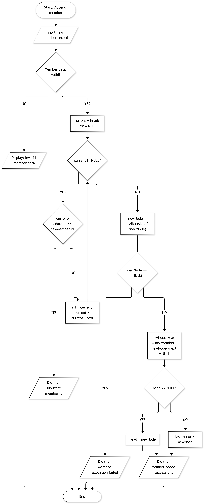

# Church Membership Management System

## Project Information

- **System Name:** Church Membership Management System
- **Course:** INSY 8321 – Data Structures and Algorithms
- **Institution:** Adventist University of Central Africa (AUCA)
- **Student Name:** MUGISHA Espoir
- **Student ID:** 27824
- **Project Number:** 31
- **Programming Language:** C

---

## Overview

The Church Membership Management System is a console-based application developed to organize and manage church membership records and service requests.

The system demonstrates the practical application of arrays, singly linked lists, queues, stacks, searching algorithms, sorting algorithms, and file handling.

It provides a centralized digital register that enables church administrators to register members, view and update their information, manage active membership, process service requests, search and sort records, undo recent changes, and preserve member information.

## Main Objectives

The main objectives of the system are to:

- Maintain organized church membership records.
- Register, display, search, update, and delete member information.
- Manage active members using a singly linked list.
- Process church service requests using the FIFO principle.
- Implement Linear Search and Binary Search.
- Organize member records using Bubble Sort.
- Maintain modification history and support undo operations using a stack.
- Save and retrieve member records using file handling.
- Demonstrate practical applications of data structures and algorithms.

## Problem Statement

Churches may manage membership information using paper documents, notebooks, or separate records. These approaches can make information difficult to locate, update, and maintain accurately.

Administrators may need to verify membership, retrieve contact information, update ministry assignments, record attendance, or process requests such as baptism, counseling, prayer, and membership transfers.

Manual record management can be time-consuming and may increase the possibility of misplaced, outdated, or inconsistent information.

The Church Membership Management System addresses these challenges by providing a structured computerized solution for managing member records, active membership, service requests, and modification history.

## Main Features

1. **Member Registration:** Register new church members and store their information.
2. **Member Record Management:** View, search, update, and delete member records.
3. **Active Membership Management:** Manage active members using a singly linked list.
4. **Service Request Management:** Submit, display, and process church requests using a queue.
5. **Searching:** Locate member records using Linear Search and Binary Search.
6. **Sorting:** Arrange member records using Bubble Sort.
7. **Modification History:** Maintain a history of changes using a stack.
8. **Undo Operations:** Reverse recent registrations, updates, and deletions.
9. **Data Persistence:** Save and retrieve member records using file handling.
10. **Member Display:** Display all registered members and their information.

## Member Information

Each member record contains the following information:

- Member ID
- First Name
- Last Name
- Gender
- Phone Number
- Email Address
- Date of Birth
- Membership Date
- Ministry or Department
- Membership Status
- Attendance Count

The Member ID uniquely identifies each member and helps prevent duplicate registrations.

---

## System Operation

### 1. Member Registration and Storage

The administrator enters the member's information. The system validates the submitted details and checks whether the Member ID already exists.

If the information is valid and the array has available capacity, the new member is stored in the primary member array.

Successful registration is also recorded in the modification history to support undo operations.

### 2. Active Membership Management

The singly linked list maintains members whose membership status is `Active`.

The primary array remains the main storage for all member records, while the linked list provides a dynamic representation of active members.

The linked list is synchronized with the member records whenever membership information or status changes.

### 3. Church Service Request Management

Members can submit requests involving:

- Membership
- Baptism
- Counseling
- Prayer
- Activity Participation
- Transfer

The system processes requests using the First-In, First-Out (FIFO) principle. This means the earliest submitted pending request is processed first.

Before accepting a request, the system verifies that the associated Member ID exists.

When a transfer request is processed, the member's status changes to `Transferred`, and the member is removed from the active-member linked list.

### 4. Searching and Sorting

The system provides searching and sorting operations to make member information easier to retrieve and organize.

- **Linear Search:** Examines member records one by one until the requested Member ID is found or all records have been checked.
- **Binary Search:** Searches for a Member ID by repeatedly dividing the search interval into two halves. The records must be sorted by Member ID in ascending order.
- **Bubble Sort:** Arranges member records by repeatedly comparing adjacent records and swapping them when necessary.

Complete member records are moved together during sorting to ensure that each member's information remains correctly associated with their identification number.

### 5. Modification History and Undo

The system uses a stack to save the previous state of the affected member before a successful registration, update, or deletion.

The stack follows the Last-In, First-Out (LIFO) principle, meaning the most recent change is reversed first.

The undo functionality supports:

- Reversing a member registration.
- Restoring previous member information after an update.
- Recovering deleted member records.

After an undo operation, the active-member linked list is synchronized with the restored records.

### 6. Saving and Loading Member Records

The system uses the `church_members.txt` file to preserve member information.

Member records can be saved and retrieved in subsequent program sessions.

When saved records are loaded, the active-member linked list is rebuilt using members whose status is `Active`.

The service-request queue and modification history are maintained in memory and are not preserved between program sessions.

---

## Data Structures and Algorithms

### 1. Array – Member Record Management

**Purpose**

The array stores the primary collection of church member records. It provides a structured way to register, display, search, update, and delete members.

**Main Operations**

- Register a new member.
- Display member records.
- Search for a member.
- Update member information.
- Delete a member.
- Check for duplicate Member IDs.
- Verify available array capacity.

**Figure 1: Array-Based Member Record Management**

**Explanation:** The flowchart follows a new member from data entry to the final result. First, the system checks whether the member array has reached `MAX_MEMBERS`. If it is full, registration stops with a capacity message. Otherwise, the entered record is validated. Invalid data is rejected. For valid data, the system checks the existing records one by one for the same Member ID. A duplicate ID is rejected; if no duplicate is found, the new record is placed in the next available array position (`members[count]`), the count is increased, and registration succeeds. The `i` and `count` steps represent the loop that scans existing IDs.

**Connection to the program:** This is the flow used when registering a member from the member-management menu. A successfully registered Active member is also added to the active linked list, and the registration is recorded so it can be undone.

**Time Complexity**

| Operation | Complexity |
|---|---|
| Duplicate ID search | O(n) |
| Insertion after validation | O(1) |
| Complete addition operation | O(n) |

### 2. Singly Linked List – Dynamic Membership Management

**Purpose**

The singly linked list manages active church members using dynamically allocated nodes connected through pointers.

Each node contains member information and a pointer to the next node.

**Main Operations**

- Insert a member.
- Search for a member.
- Display active members.
- Remove a member.
- Count active members.
- Release allocated memory.

**Figure 2: Singly Linked List Dynamic Membership Management**

**Explanation:** This flowchart illustrates appending a member node to the end of a singly linked list. The system first validates the member data, then starts at `head` and follows each node's `next` pointer. While traversing, it checks whether the Member ID is already present. A duplicate is rejected. If the end (`current == NULL`) is reached without finding a duplicate, the program allocates a new node and checks whether allocation succeeded. The new node stores the member data and has `next = NULL`. If the list is empty, the new node becomes `head`; otherwise, the last node's `next` pointer is set to the new node.

**Connection to the program:** Only Active members belong in this list, and their full records remain in the array as the primary storage. The diagram focuses on insertion at the end; the program also supports inserting at the beginning, searching, deleting, displaying, and counting active members.

**Time Complexity**

| Operation | Complexity |
|---|---|
| Traversal | O(n) |
| Duplicate detection | O(n) |
| Linking a new node after traversal | O(1) |
| Complete insertion operation | O(n) |

### 3. Queue – Church Service Request Processing

**Purpose**

The queue manages church service requests using the First-In, First-Out (FIFO) principle.

The first request submitted is the first request processed.

**Main Operations**

- Submit a service request (Enqueue).
- Process the oldest request (Dequeue).
- Display pending requests.
- Check whether the queue is empty.

The program stores requests in a fixed-size circular array with a capacity of 20. When the rear reaches the end of the array, it wraps around to the beginning if there is space.

**Figure 3: Queue-Based Church Service Request Processing**

**Explanation:** The flowchart shows a request menu with three choices: submit a request, process the next request, or exit. For submission, the request details are checked and a new request is added at the rear. If the queue is empty, that request becomes both the front and rear; otherwise, it is linked after the current rear. For processing, the request at the front is removed. If that was the only request, both front and rear become empty. Otherwise, front advances to the next request. This is FIFO behavior: the oldest waiting request is handled first. Invalid choices, invalid request data, an empty queue, and allocation failure each have their own outcome.

**Connection to the program:** The program follows the same FIFO order, but its actual queue is a fixed-size circular array (`QUEUE_CAPACITY` is 20), not a linked list of dynamically allocated request nodes as drawn in this figure. Requests are entered only for existing members. Processing a Transfer request also changes that member's status and removes them from the active-member list.

**Time Complexity**

| Operation | Complexity |
|---|---|
| Enqueue | O(1) |
| Dequeue | O(1) |

### 4. Searching and Sorting Algorithms

**Purpose**

Searching and sorting algorithms help administrators locate member records and organize information efficiently.

**A. Linear Search**

Linear Search examines each member record sequentially until the requested Member ID is found or all records have been checked.

The array does not need to be sorted.

**B. Binary Search**

Binary Search locates a member by repeatedly dividing the search interval into two halves.

The member records must be sorted by Member ID in ascending order before performing the search.

**C. Bubble Sort**

Bubble Sort repeatedly compares adjacent member records and swaps them when they are in the wrong order.

The complete member records must be swapped together to maintain data consistency.

**Figure 4: Member Searching and Sorting Algorithms**

**Explanation:** This figure combines three algorithm paths selected from a menu:

- **Linear Search:** The program asks for a target Member ID, starts at array index `i = 0`, and compares each record's ID with the target. It displays the matching member when found; if it reaches the end without a match, it reports that the member was not found.
- **Binary Search:** The program searches a Member-ID-sorted sequence by checking the middle record. If the target is smaller, it continues in the left half; if larger, it continues in the right half. It repeats until it finds the ID or the search interval is empty. Each step discards about half of the remaining candidates.
- **Bubble Sort:** The program compares adjacent records and swaps them when they are out of order. It repeats passes until the records are in the requested order, then displays the sorted results.

**Important implementation detail:** The diagram's sort branch depicts sorting by Member ID, but the program's Bubble Sort menu sorts by attendance in ascending or descending order. For Binary Search, the program makes a separate copy of the records and sorts that copy by Member ID before searching, so it does not disturb the main array's current order.

**Time Complexity**

| Algorithm | Worst-Case Complexity |
|---|---|
| Linear Search | O(n) |
| Bubble Sort | O(n²) |
| Binary Search | O(log n) |
| Bubble Sort followed by Binary Search | O(n²) |

### 5. Stack – Modification History and Undo

**Purpose**

The stack maintains modification history and allows administrators to reverse recent changes.

It follows the Last-In, First-Out (LIFO) principle.

Each history entry stores the affected member's previous data, the operation type, and the member's array index.

**Main Operations**

- Push the previous member state onto the stack.
- Check whether the stack is full.
- Check whether the stack is empty.
- Undo the most recent modification.
- Restore previously saved member records.

**Figure 5: Stack-Based Modification History and Undo**

**Explanation:** The flowchart begins with `top = -1`, which represents an empty stack, and presents choices to add, modify, delete, undo, or exit. For a register, update, or delete, it checks whether the selected choice is valid, prepares the requested change, and validates it before applying it. If validation fails, the current member data stays unchanged. When a change succeeds, its prior state is pushed onto the stack and the updated record is committed. Undo checks whether the stack is empty; if it is not, it restores the most recent saved state, decrements `top`, and reports that the latest change was undone. This demonstrates Last-In, First-Out (LIFO): the most recent change is reversed first.

**Connection to the program:** The program records the affected member's previous values, operation type, and array position rather than copying the entire member array for every operation. The stack holds up to 50 entries; when full, the program discards the oldest entry to make room for a new one. The diagram's full-stack branch shows a different policy, so that branch does not match the implementation. Undo reverses supported registration, update, and deletion operations and synchronizes the active-member linked list afterward.

**Time Complexity**

| Operation | Complexity |
|---|---|
| Push a history entry when the stack is not full | O(1) |
| Push when full (discard oldest entry) | O(STACK_CAPACITY) |
| Undo an update | O(1) |
| Undo a registration or deletion | O(n) worst case, due to shifting array records |
| History storage | O(STACK_CAPACITY) member snapshots |

The system supports undo operations but does not currently include redo functionality.

---

## Main Menu Structure

The application provides the following main menu sections:

| Option | Feature | Description |
|---|---|---|
| 1 | Member Record Management | Register, update, delete, and search members. |
| 2 | Dynamic Membership Management | Manage active members using a linked list. |
| 3 | Church Service Request Management | Submit, display, and process requests. |
| 4 | Searching and Sorting | Search and organize member records. |
| 5 | Modification History and Undo | View history and reverse recent changes. |
| 6 | Display All Members | Display all stored member records. |
| 7 | Save and Load Records | Save and retrieve member information. |
| 0 | Exit | Close the application. |

## Importance of the System

The Church Membership Management System is important because it:

- Demonstrates how different data structures work together in one application.
- Provides an organized approach to managing church membership information.
- Makes it easier to locate and update member records.
- Supports orderly processing of church service requests.
- Demonstrates the practical use of arrays, pointers, structures, dynamic memory, and file handling.
- Provides an undo mechanism for reversing recent changes.
- Preserves member records for future use.

## Social Benefits

The system can provide several benefits to churches and their communities:

- **Improved Pastoral Support:** Helps church leaders identify members, ministries, and service needs.
- **Faster Member Assistance:** Makes it easier to retrieve contact information and manage service requests.
- **Organized Church Services:** Helps organize baptism, counseling, prayer, transfer, and activity requests.
- **Improved Communication:** Organized contact information supports communication with church members.
- **Ministry Coordination:** Helps organize members according to their ministries and departments.
- **Attendance Monitoring:** Helps church leaders follow up on attendance and member participation.
- **Accountability:** Organized records and modification history make changes easier to review.
- **Community Care:** Supports the organization of prayer, counseling, and community activities.

Member information should be handled responsibly. Access should be restricted to authorized church representatives, and personal information should only be shared for legitimate purposes.

## System Limitations

The current version is a console-based application that stores member records in a plain text file.

It does not currently provide:

- User accounts and password authentication.
- Network-based access.
- Database integration.
- Role-based access permissions.
- Persistent storage for service requests.
- Persistent storage for modification history.
- Redo functionality.

Possible future improvements include database integration, user authentication, improved privacy controls, automatic backups, and a graphical user interface.

## Conclusion

The Church Membership Management System demonstrates how different data structures and algorithms can be integrated into one application to manage church membership information and service requests.

Through the implementation of arrays, singly linked lists, queues, stacks, searching algorithms, sorting algorithms, and file handling, the system provides an organized approach to managing member records and administrative activities.

The five flowcharts illustrate the major operations, processing steps, and decision-making processes involved in the application.

Overall, the project demonstrates the practical importance of data structures and algorithms in solving real-world information-management problems.