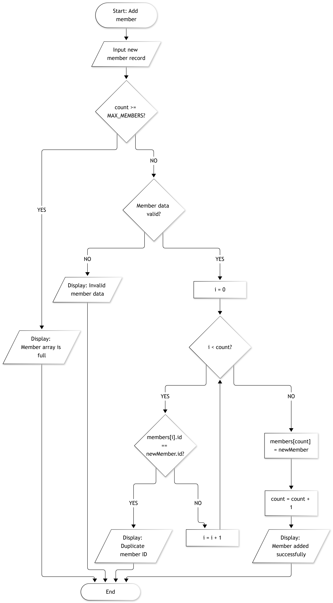
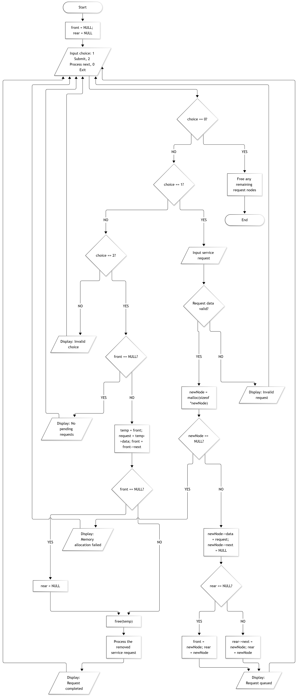
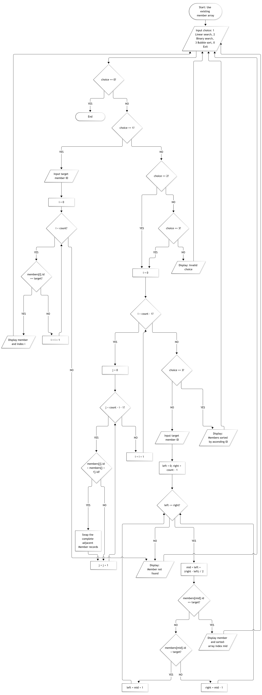
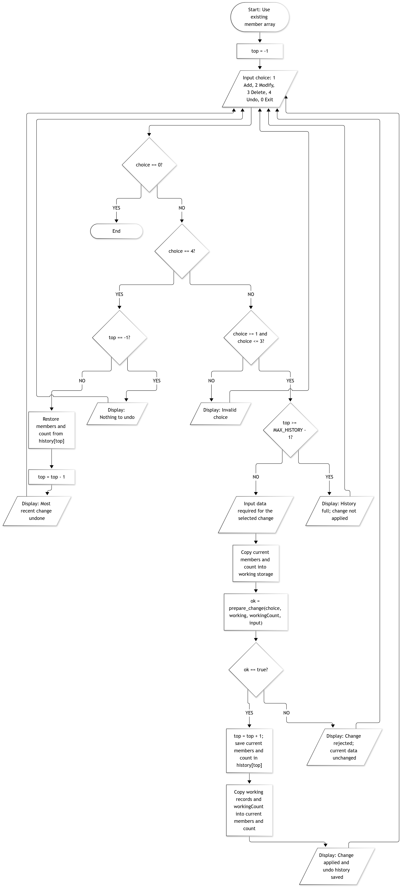

# Church Membership Management System

## Project Information

- **System Name:** Church Membership Management System
- **Course:** INSY 8321 – Data Structures and Algorithms
- **Institution:** Adventist University of Central Africa (AUCA)
- **Student Name:** MUGISHA Espoir
- **Student ID:** 27824
- **Project Number:** 31
- **Programming Language:** C

---

## Overview

The Church Membership Management System is a console-based application developed to organize and manage church membership records and service requests.

The system demonstrates the practical application of arrays, singly linked lists, queues, stacks, searching algorithms, sorting algorithms, and file handling.

It provides a centralized digital register that enables church administrators to register members, view and update their information, manage active membership, process service requests, search and sort records, undo recent changes, and preserve member information.

## Main Objectives

The main objectives of the system are to:

- Maintain organized church membership records.
- Register, display, search, update, and delete member information.
- Manage active members using a singly linked list.
- Process church service requests using the FIFO principle.
- Implement Linear Search and Binary Search.
- Organize member records using Bubble Sort.
- Maintain modification history and support undo operations using a stack.
- Save and retrieve member records using file handling.
- Demonstrate practical applications of data structures and algorithms.

## Problem Statement

Churches may manage membership information using paper documents, notebooks, or separate records. These approaches can make information difficult to locate, update, and maintain accurately.

Administrators may need to verify membership, retrieve contact information, update ministry assignments, record attendance, or process requests such as baptism, counseling, prayer, and membership transfers.

Manual record management can be time-consuming and may increase the possibility of misplaced, outdated, or inconsistent information.

The Church Membership Management System addresses these challenges by providing a structured computerized solution for managing member records, active membership, service requests, and modification history.

## Main Features

1. **Member Registration:** Register new church members and store their information.
2. **Member Record Management:** View, search, update, and delete member records.
3. **Active Membership Management:** Manage active members using a singly linked list.
4. **Service Request Management:** Submit, display, and process church requests using a queue.
5. **Searching:** Locate member records using Linear Search and Binary Search.
6. **Sorting:** Arrange member records using Bubble Sort.
7. **Modification History:** Maintain a history of changes using a stack.
8. **Undo Operations:** Reverse recent registrations, updates, and deletions.
9. **Data Persistence:** Save and retrieve member records using file handling.
10. **Member Display:** Display all registered members and their information.

## Member Information

Each member record contains the following information:

- Member ID
- First Name
- Last Name
- Gender
- Phone Number
- Email Address
- Date of Birth
- Membership Date
- Ministry or Department
- Membership Status
- Attendance Count

The Member ID uniquely identifies each member and helps prevent duplicate registrations.

---

## System Operation

### 1. Member Registration and Storage

The administrator enters the member's information. The system validates the submitted details and checks whether the Member ID already exists.

If the information is valid and the array has available capacity, the new member is stored in the primary member array.

Successful registration is also recorded in the modification history to support undo operations.

### 2. Active Membership Management

The singly linked list maintains members whose membership status is `Active`.

The primary array remains the main storage for all member records, while the linked list provides a dynamic representation of active members.

The linked list is synchronized with the member records whenever membership information or status changes.

### 3. Church Service Request Management

Members can submit requests involving:

- Membership
- Baptism
- Counseling
- Prayer
- Activity Participation
- Transfer

The system processes requests using the First-In, First-Out (FIFO) principle. This means the earliest submitted pending request is processed first.

Before accepting a request, the system verifies that the associated Member ID exists.

When a transfer request is processed, the member's status changes to `Transferred`, and the member is removed from the active-member linked list.

### 4. Searching and Sorting

The system provides searching and sorting operations to make member information easier to retrieve and organize.

- **Linear Search:** Examines member records one by one until the requested Member ID is found or all records have been checked.
- **Binary Search:** Searches for a Member ID by repeatedly dividing the search interval into two halves. The records must be sorted by Member ID in ascending order.
- **Bubble Sort:** Arranges member records by repeatedly comparing adjacent records and swapping them when necessary.

Complete member records are moved together during sorting to ensure that each member's information remains correctly associated with their identification number.

### 5. Modification History and Undo

The system uses a stack to maintain snapshots of member records before successful modifications.

The stack follows the Last-In, First-Out (LIFO) principle, meaning the most recent change is reversed first.

The undo functionality supports:

- Reversing a member registration.
- Restoring previous member information after an update.
- Recovering deleted member records.

After an undo operation, the active-member linked list is synchronized with the restored records.

### 6. Saving and Loading Member Records

The system uses the `church_members.txt` file to preserve member information.

Member records can be saved and retrieved in subsequent program sessions.

When saved records are loaded, the active-member linked list is rebuilt using members whose status is `Active`.

The service-request queue and modification history are maintained in memory and are not preserved between program sessions.

---

## Data Structures and Algorithms

### 1. Array – Member Record Management

**Purpose**

The array stores the primary collection of church member records. It provides a structured way to register, display, search, update, and delete members.

**Main Operations**

- Register a new member.
- Display member records.
- Search for a member.
- Update member information.
- Delete a member.
- Check for duplicate Member IDs.
- Verify available array capacity.

**Flowchart – Figure 1**

*Figure 1: Flowchart illustrating the process of adding and managing church member records using an array.*

**Time Complexity**

| Operation | Complexity |
|---|---|
| Duplicate ID search | O(n) |
| Insertion after validation | O(1) |
| Complete addition operation | O(n) |

### 2. Singly Linked List – Dynamic Membership Management

**Purpose**

The singly linked list manages active church members using dynamically allocated nodes connected through pointers.

Each node contains member information and a pointer to the next node.

**Main Operations**

- Insert a member.
- Search for a member.
- Display active members.
- Remove a member.
- Count active members.
- Release allocated memory.

**Flowchart – Figure 2**

*Figure 2: Flowchart illustrating dynamic member management using a singly linked list.*

**Time Complexity**

| Operation | Complexity |
|---|---|
| Traversal | O(n) |
| Duplicate detection | O(n) |
| Linking a new node after traversal | O(1) |
| Complete insertion operation | O(n) |

### 3. Queue – Church Service Request Processing

**Purpose**

The queue manages church service requests using the First-In, First-Out (FIFO) principle.

The first request submitted is the first request processed.

**Main Operations**

- Submit a service request (Enqueue).
- Process the oldest request (Dequeue).
- Display pending requests.
- Check whether the queue is empty.
- Release allocated queue nodes.

**Flowchart – Figure 3**

*Figure 3: Flowchart illustrating church service request submission and processing using a FIFO queue.*

**Time Complexity**

| Operation | Complexity |
|---|---|
| Enqueue | O(1) |
| Dequeue | O(1) |

### 4. Searching and Sorting Algorithms

**Purpose**

Searching and sorting algorithms help administrators locate member records and organize information efficiently.

**A. Linear Search**

Linear Search examines each member record sequentially until the requested Member ID is found or all records have been checked.

The array does not need to be sorted.

**B. Binary Search**

Binary Search locates a member by repeatedly dividing the search interval into two halves.

The member records must be sorted by Member ID in ascending order before performing the search.

**C. Bubble Sort**

Bubble Sort repeatedly compares adjacent member records and swaps them when they are in the wrong order.

The complete member records must be swapped together to maintain data consistency.

**Flowchart – Figure 4**

*Figure 4: Flowchart illustrating the searching and sorting operations used to organize and retrieve church member records.*

**Time Complexity**

| Algorithm | Worst-Case Complexity |
|---|---|
| Linear Search | O(n) |
| Bubble Sort | O(n²) |
| Binary Search | O(log n) |
| Bubble Sort followed by Binary Search | O(n²) |

### 5. Stack – Modification History and Undo

**Purpose**

The stack maintains modification history and allows administrators to reverse recent changes.

It follows the Last-In, First-Out (LIFO) principle.

Each history entry stores a snapshot of member records and the member count before a successful modification.

**Main Operations**

- Push the previous member state onto the stack.
- Check whether the stack is full.
- Check whether the stack is empty.
- Undo the most recent modification.
- Restore previously saved member records.

**Flowchart – Figure 5**

*Figure 5: Flowchart illustrating modification history and undo operations using a LIFO stack.*

**Time Complexity**

| Operation | Complexity |
|---|---|
| Stack index update | O(1) |
| Saving a member snapshot | O(n) |
| Restoring a member snapshot | O(n) |
| Snapshot storage | O(MAX_HISTORY × MAX_MEMBERS) |

The system supports undo operations but does not currently include redo functionality.

---

## Main Menu Structure

The application provides the following main menu sections:

| Option | Feature | Description |
|---|---|---|
| 1 | Member Record Management | Register, update, delete, and search members. |
| 2 | Dynamic Membership Management | Manage active members using a linked list. |
| 3 | Church Service Request Management | Submit, display, and process requests. |
| 4 | Searching and Sorting | Search and organize member records. |
| 5 | Modification History and Undo | View history and reverse recent changes. |
| 6 | Display All Members | Display all stored member records. |
| 7 | Save and Load Records | Save and retrieve member information. |
| 0 | Exit | Close the application. |

## Importance of the System

The Church Membership Management System is important because it:

- Demonstrates how different data structures work together in one application.
- Provides an organized approach to managing church membership information.
- Makes it easier to locate and update member records.
- Supports orderly processing of church service requests.
- Demonstrates the practical use of arrays, pointers, structures, dynamic memory, and file handling.
- Provides an undo mechanism for reversing recent changes.
- Preserves member records for future use.

## Social Benefits

The system can provide several benefits to churches and their communities:

- **Improved Pastoral Support:** Helps church leaders identify members, ministries, and service needs.
- **Faster Member Assistance:** Makes it easier to retrieve contact information and manage service requests.
- **Organized Church Services:** Helps organize baptism, counseling, prayer, transfer, and activity requests.
- **Improved Communication:** Organized contact information supports communication with church members.
- **Ministry Coordination:** Helps organize members according to their ministries and departments.
- **Attendance Monitoring:** Helps church leaders follow up on attendance and member participation.
- **Accountability:** Organized records and modification history make changes easier to review.
- **Community Care:** Supports the organization of prayer, counseling, and community activities.

Member information should be handled responsibly. Access should be restricted to authorized church representatives, and personal information should only be shared for legitimate purposes.

## System Limitations

The current version is a console-based application that stores member records in a plain text file.

It does not currently provide:

- User accounts and password authentication.
- Network-based access.
- Database integration.
- Role-based access permissions.
- Persistent storage for service requests.
- Persistent storage for modification history.
- Redo functionality.

Possible future improvements include database integration, user authentication, improved privacy controls, automatic backups, and a graphical user interface.

## Conclusion

The Church Membership Management System demonstrates how different data structures and algorithms can be integrated into one application to manage church membership information and service requests.

Through the implementation of arrays, singly linked lists, queues, stacks, searching algorithms, sorting algorithms, and file handling, the system provides an organized approach to managing member records and administrative activities.

The five flowcharts illustrate the major operations, processing steps, and decision-making processes involved in the application.

Overall, the project demonstrates the practical importance of data structures and algorithms in solving real-world information-management problems.